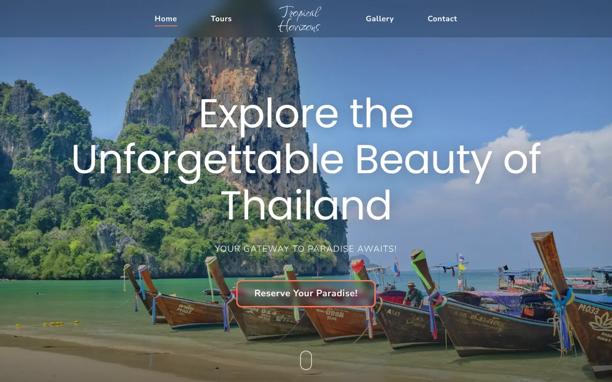

# Tropical Horizons — Travel to Thailand

Landing page for a fictional Thailand tour agency, built from my own Figma design (2025).

**Live:** https://moraxxvi.github.io/travel-to-thailand-/

- Pure HTML / CSS / JS, no frameworks
- Design tokens from the Figma style guide: Poppins + Nunito Sans + Fuggles, `#FF7A59` / `#252525` / `#FFCBB2`, 4px spacing scale, 150px edge margins
- Scroll reveals, parallax capsule photos, animated 8-day "snake" program, booking modal, review carousel with swipe, gallery lightbox + slideshow
- Fully responsive, respects `prefers-reduced-motion`
- Photos from [Unsplash](https://unsplash.com), converted to WebP

Design & code — Mansur ([@moraxxvi](https://github.com/moraxxvi))
